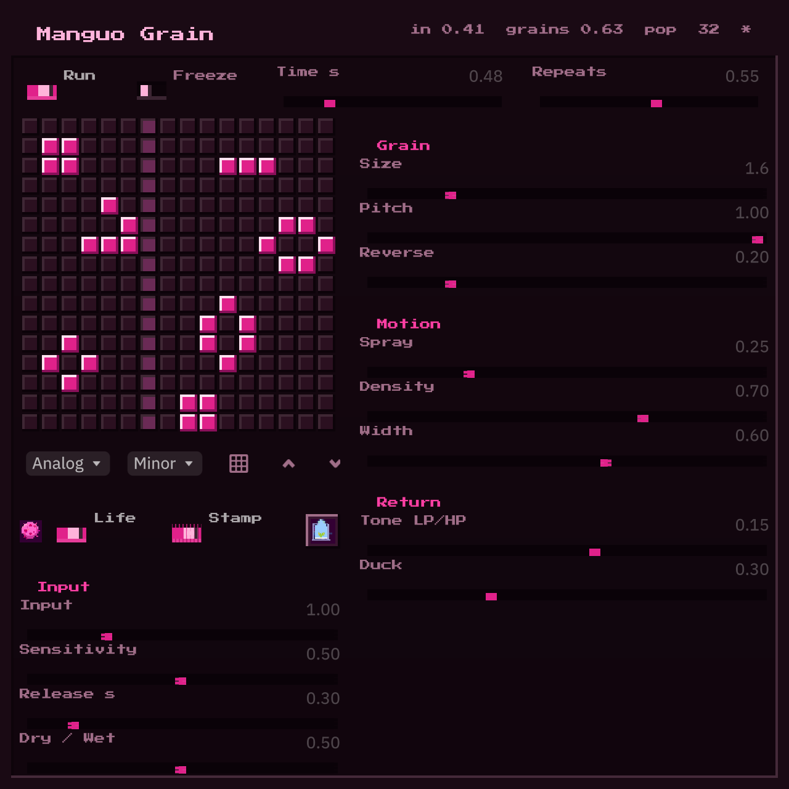

```
██······██····██████····██······██····████████··██······██····██████····
████··████··██······██··████····██··██··········██······██··██······██··
██··██··██··██████████··██··██··██··██··██████··██······██··██······██··
██······██··██······██··██····████··██······██··██······██··██······██··
██······██··██······██··██······██····████████····██████······██████····
```

# Manguo

A Game-of-Life granular instrument, written in Rust — audio engine, plugin
and UI alike — on the [Makepad](https://github.com/makepad/makepad) UI framework.

Sound is recorded into a 16×16 grid of cells. A playhead walks the columns;
every live cell holds a grain and plays it when the playhead passes. Each pass
is one generation: the grid evolves by Conway's rules and the repeats mutate
with it, degrading as digital, analog or tape.

<p align="center">
  <a href="examples/manguo_grain/README.md"></a>
</p>

## Manguo Grain — the plugin

The granular delay as a VST3 / CLAP plugin, for any DAW.

| Platform | Download |
| --- | --- |
| macOS (Apple Silicon) | **[Manguo-Grain-macOS-arm64.zip](https://github.com/roy-shiloh/manguo/releases/latest/download/Manguo-Grain-macOS-arm64.zip)** |
| Windows (x64) | **[Manguo-Grain-Windows-x64.zip](https://github.com/roy-shiloh/manguo/releases/latest/download/Manguo-Grain-Windows-x64.zip)** |

Install steps, the control reference and build notes are in
[`examples/manguo_grain/README.md`](examples/manguo_grain/README.md).

## Manguo — the instrument

The full app: an Ironfish-based synth driven by your voice through the mic,
feeding the same Life grain sequencer. It lives in
[`examples/manguo`](examples/manguo); on macOS build an app bundle with

```sh
examples/manguo/bundle_macos.sh
```

which places `Manguo.app` in `~/Applications`.

## Repository layout

- `examples/manguo_grain/` — the plugin crate (engine, nice-plug params, Makepad editor, bundling script).
- `examples/manguo/` — the instrument app and its presets.
- `.github/workflows/manguo-grain.yml` — builds the macOS and Windows zips and attaches them to a release on every `v*` tag.
- everything else — a fork of [Makepad](https://github.com/makepad/makepad), the Rust UI framework both apps are built on, with the additions Manguo needs (an embedded render context for plugin host windows on macOS/Metal and Windows/D3D11, among others).

## License

MIT — see [`LICENSE`](LICENSE). Manguo, Manguo Grain and the fork changes are
© 2026 Roy Shiloh; [Makepad](https://github.com/makepad/makepad) is © Makepad B.V.
